

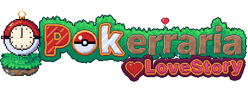

**English** · [Português (BR)](README.pt-BR.md)

### Catch 'em all in Terraria. Beat the bosses. Earn the badges. Become the Champion.

  

**[What is it](#-what-is-pokerraria)** · **[First steps](#-your-first-steps)** · **[The story](#-a-story-across-time)** · **[Battles](#%EF%B8%8F-real-pok%C3%A9mon-battles)** · **[The League](#-the-road-to-the-league)** · **[Install](#-install)** · **[Plans](#%EF%B8%8F-whats-next)** · **[Credits](#-credits)**

---

## 🌱 What is Pokerraria?

**Pokerraria: LoveStory** turns Terraria into a full Pokémon journey, in the spirit of Cobblemon for Minecraft. You pick a partner from Professor Oak, catch wild Pokémon in every biome, and battle them in **real turn-based Pokémon battles** (the same rules as the main games, powered by Pokémon Showdown) right there in your world.

Your Terraria progress and your Pokémon journey are one and the same: **every boss you defeat opens the door to a new Gym Leader**, wild Pokémon grow stronger as your world does, and your badges decide how strong a Pokémon will still obey you. Beat all eight Gyms, the Elite Four and the Champion to enter the Hall of Fame.

It started as a fan fork of [Terramon](https://github.com/JamzOJamz/Terramon) and grew into its own game, made in Brazil 🇧🇷 and playable in Portuguese and English.

## 🧭 Your first steps

New to the mod? This is the whole loop, from your first world to the Champion.

1. **Create a new world.** The Gyms, the League buildings and a **Pokémon Center** next to spawn are built while the world is generated, so an old world won't have them.
2. **Meet Professor Oak.** He arrives on your first day, explains how everything works and lets you **choose your first partner**. You can call him again later to hear it all once more.
3. **Catch Pokémon.** Throw a Poké Ball at a wild Pokémon. Weaken it first: low HP and status conditions (sleep, paralysis...) make it much easier to catch. Different Pokémon live in different biomes, at different times and depths.
4. **Battle.** Walk up to a wild Pokémon or a trainer and the battle starts in place, with the classic menu: **Fight, Bag, Pokémon and Run**.
5. **Heal up.** Nurse Joy heals your whole team for free at the Pokémon Center, and the area around your base is a **safe zone** where wild Pokémon stay weak.
6. **Beat a Terraria boss, then its Gym Leader.** The Eye of Cthulhu opens Brock's Gym, and every badge raises the **level cap** of your team (see [the League](#-the-road-to-the-league)).
7. **Keep going** until the Elite Four and Champion Blue. The Moon Lord stands before the last battle.

> 💡 **Level cap:** a Pokémon above the cap of your badges may ignore your orders in battle, use another move or take a nap. With no badges the cap is 15; it goes up with every badge, and the Champion has none.

## 📜 A story across time

Pokerraria is called *LoveStory* for a reason. Kanto and Terraria were never meant to share a world, and someone knew you would come long before you did.

There is a story waiting for you along the road to the League, told through what you find on your journey. We won't say more here: it's best discovered in game. **The first chapters are being written now** and will arrive in the next versions.

## ⚔️ Real Pokémon battles

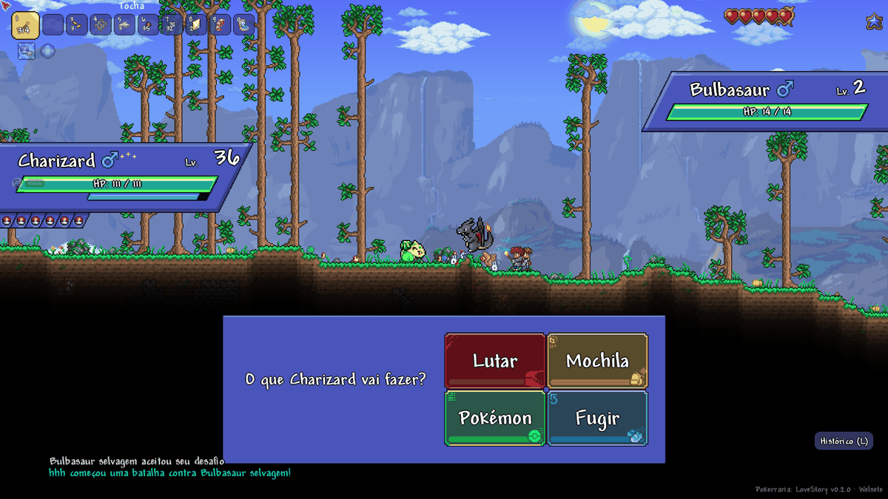

<table>
<tr>
<td width="50%">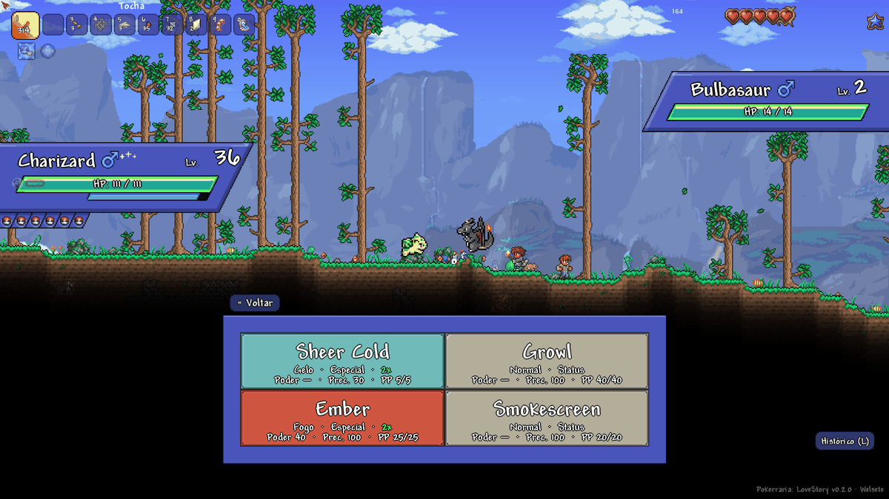</td>
<td width="50%">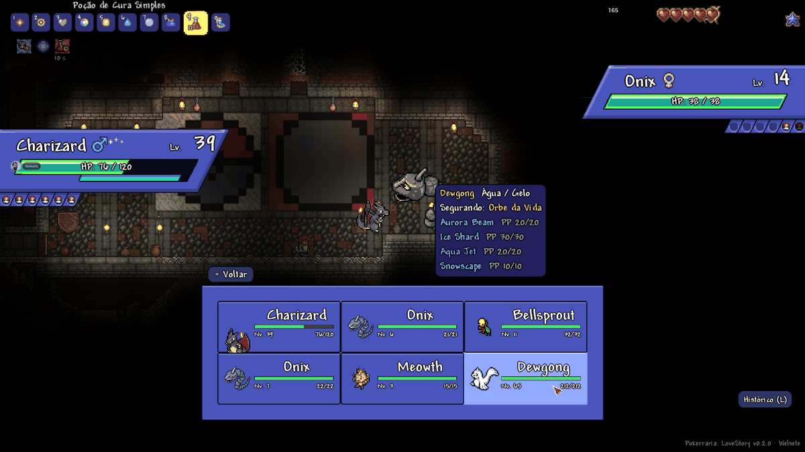</td>
</tr>
<tr>
<td align="center">Every move shows its type, category, power, accuracy and PP.</td>
<td align="center">Hover a Pokémon to see its types, held item and moves before switching.</td>
</tr>
</table>

- **The real rules:** types, abilities, natures, IVs and EVs, critical hits, status conditions, stat changes, weather (rain, sun, sandstorm, snow), terrains and screens, all shown around the battle.
- **Paced like the games:** text written letter by letter, HP bars that drain, "It's super effective!" after the hit. Click to speed it up, or press <kbd>L</kbd> for the **battle history** of the whole fight.
- **Drawn move animations** for Fire Blast, Ember, Flamethrower, Solar Beam, Ice Beam, Aurora Beam, Blizzard, Sheer Cold, Bullet Punch, Ice Punch, Ice Fang, Ice Shard, Icicle Spear, Icicle Crash, Icy Wind, Powder Snow, Freeze-Dry and Haze. Beams travel from one Pokémon to the other and multi-hit moves play every hit. Every other move gets an effect by type, and more drawn animations arrive with each version.
- **Smart trainers** that play type matchups, STAB, setup and healing moves, and switch out when it pays off.
- **Bag in battle:** Potions, Revives and Poké Balls on your turn.
- **22 held items** drawn for the mod: Leftovers, Oran and Sitrus Berries, type boosters, Focus Sash, Life Orb, King's Rock, Shell Bell and more.
- **Play together:** challenge friends to PvP battles that heal both teams afterwards, with everyone's Pokémon synced in multiplayer.

## 🏆 The road to the League

<table>
<tr>
<td width="50%">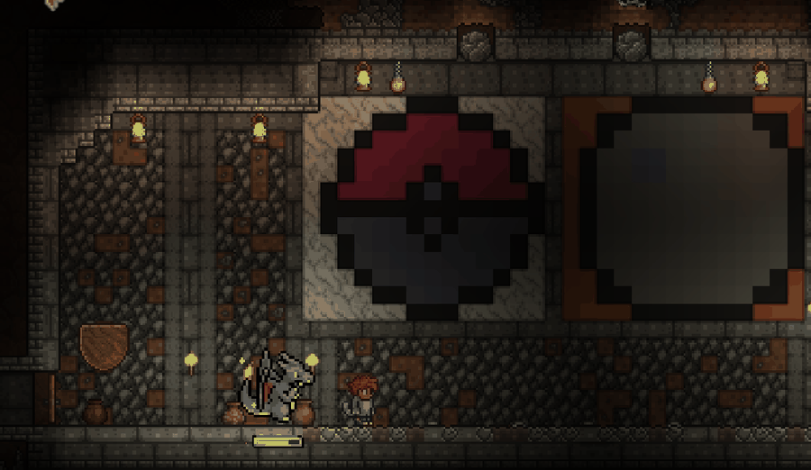</td>
<td width="50%">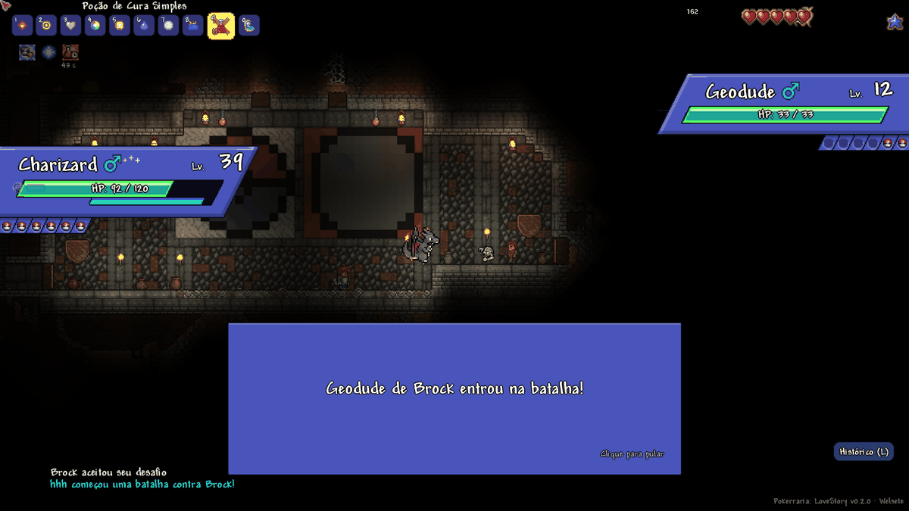</td>
</tr>
<tr>
<td align="center">Brock's Gym waits in a cave close to spawn.</td>
<td align="center">Gym Leaders fight with full teams and real strategies.</td>
</tr>
</table>

Each Gym Leader accepts your challenge after a Terraria boss and the previous badge. Talk to them in their Gym, or call them with their challenge item, crafted at a Work Bench. Every badge also raises your team's level cap.

| | Leader | Unlocked by | Badge | Level cap |
|:-:|---|---|---|:-:|
| | *No badges yet* | | | 15 |
| 1 | Brock | Eye of Cthulhu | Boulder Badge | 21 |
| 2 | Misty | Eater of Worlds or Brain of Cthulhu | Cascade Badge | 27 |
| 3 | Lt. Surge | Skeletron | Thunder Badge | 33 |
| 4 | Erika | Wall of Flesh (Hardmode) | Rainbow Badge | 39 |
| 5 | Koga | Any mechanical boss | Soul Badge | 45 |
| 6 | Sabrina | All three mechanical bosses | Marsh Badge | 50 |
| 7 | Blaine | Plantera | Volcano Badge | 55 |
| 8 | Giovanni | Golem | Earth Badge | 62 |
| | **Elite Four** | 8 badges and the Lunatic Cultist | Lorelei, Bruno, Agatha, Lance | |
| | **Champion Blue** | Moon Lord | Hall of Fame | no limit |

### Pokémon Center

A Pokémon Center is built next to spawn in every new world. **Nurse Joy** heals your team for free, Chansey and Blissey walk around helping her, and it has a **PC** for your boxes. PCs can also be placed in any valid house. It even plays the Pokémon Center music.

## 🐾 Pokémon that feel alive

All 151 Kanto Pokémon and Lucario use sprites from the **PMD SpriteCollab**, with up to 15 animations each: idle, walk, physical attack, special attack, status move, hurt, sleep, faint, hop, lying down, waking up, tripping on a miss, eating when healed and a victory pose. Your partner follows you around the world, and each Pokémon has its real size.

<table>
<tr>
<td width="50%">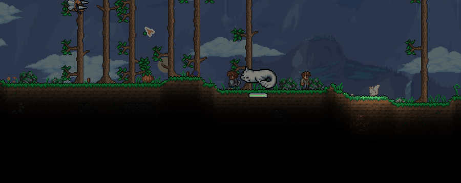</td>
<td width="50%"></td>
</tr>
<tr>
<td align="center">Your partner walks with you everywhere.</td>
<td align="center">Every Pokémon has its shiny form, with a sparkle when one shows up.</td>
</tr>
</table>

**Partner perks:** your Pokémon helps you by its type. Fire lights the way, Water lets you breathe longer, Ground mines faster, and Lucario's aura makes ores glow in caves.

**Evolution** happens right on your Pokémon in the world, with the classic white light and its own music (<kbd>B</kbd> to skip):

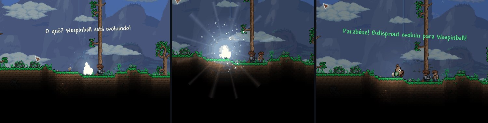

## 📖 Know your team

<table>
<tr>
<td width="50%">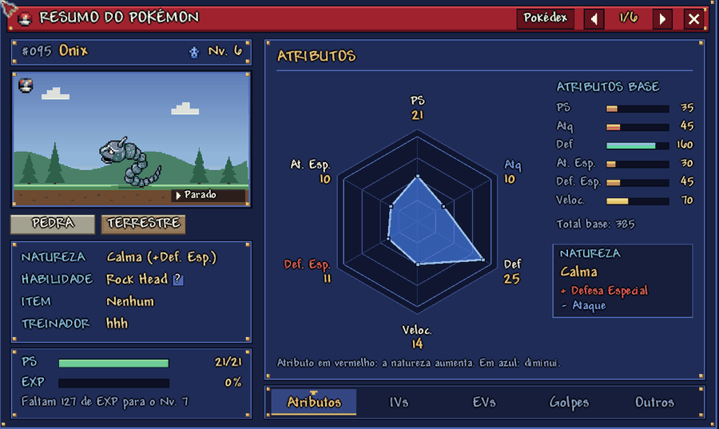</td>
<td width="50%">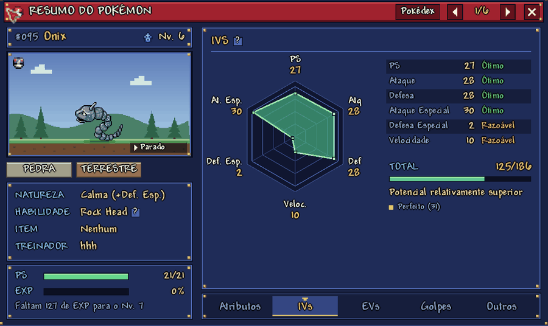</td>
</tr>
<tr>
<td width="50%">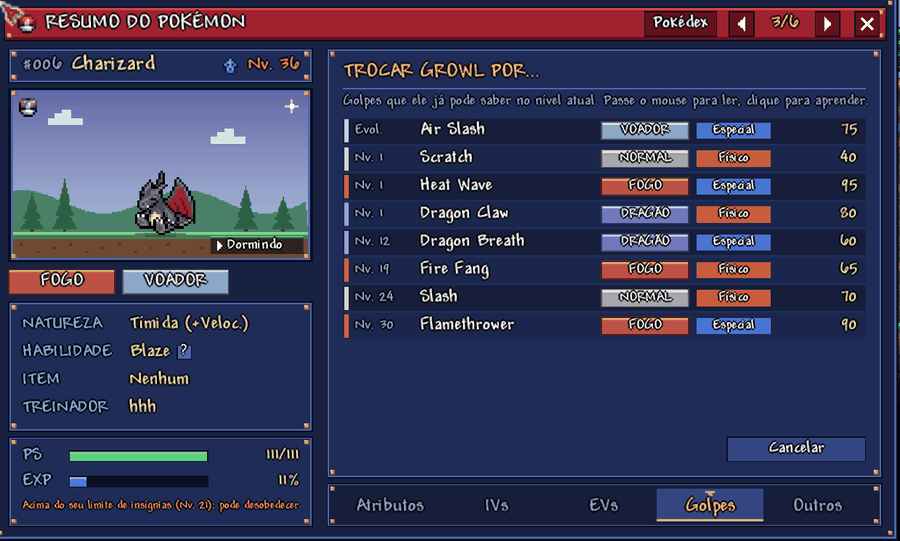</td>
<td width="50%">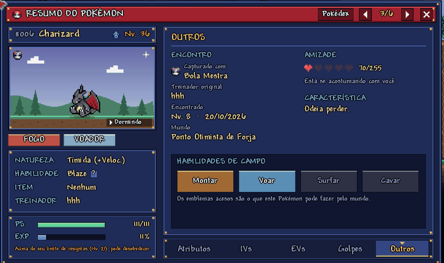</td>
</tr>
</table>

The **Summary screen** (<kbd>I</kbd>, or middle click on a Pokémon) shows everything about each Pokémon, explained in plain words:

- **Stats, IVs and EVs** as radar charts. Hover anything to learn what it means.
- **Nature, ability** (with its description), **held item** and **original trainer**.
- **Moves** with power, accuracy, PP and description, and you can **change moves at any time** to any move it could have learned by its level.
- **Where and when it was met**, with which Poké Ball, its **friendship** and its **field abilities** (ride, fly, surf, dig).

<table>
<tr>
<td width="33%">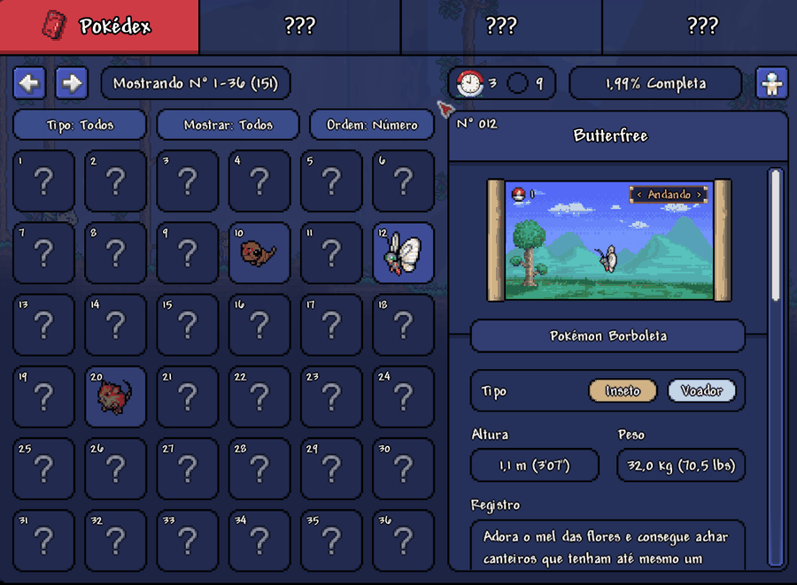</td>
<td width="33%">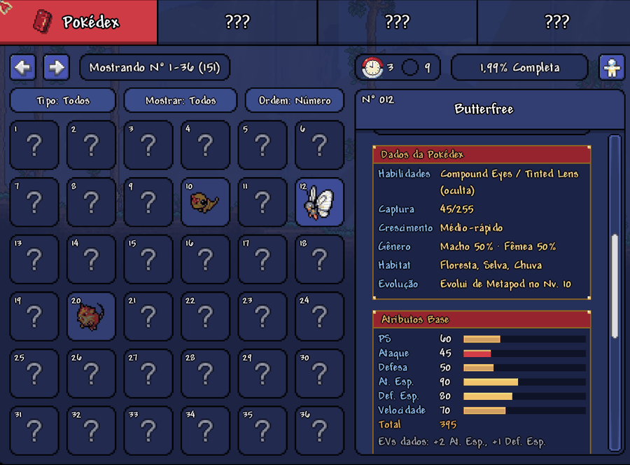</td>
<td width="33%">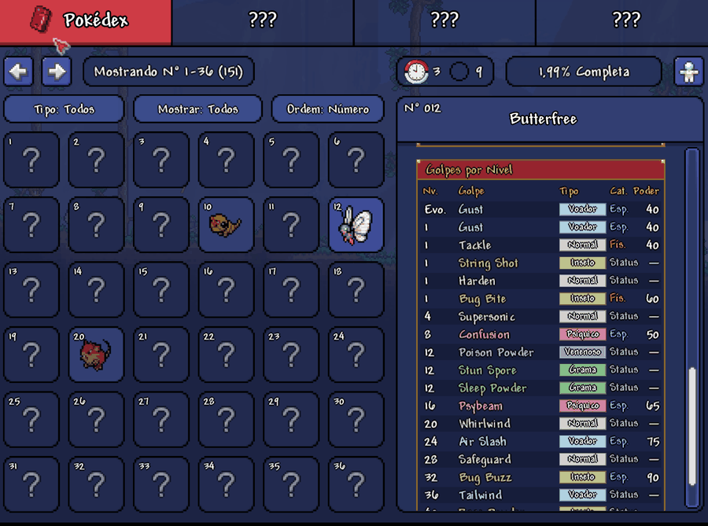</td>
</tr>
</table>

The **Pokédex** (<kbd>P</kbd>) has an animated preview of each Pokémon, its abilities, catch rate, growth, habitat, evolution, base stats and level-up moves. Filter it by **type**, by **caught or seen**, and sort by number or name.

<table>
<tr>
<td width="22%" valign="top">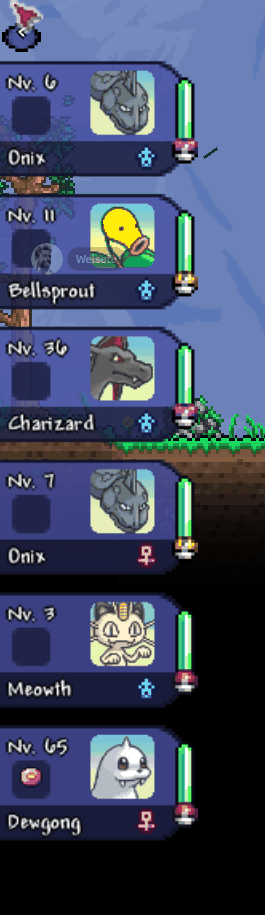</td>
<td valign="top">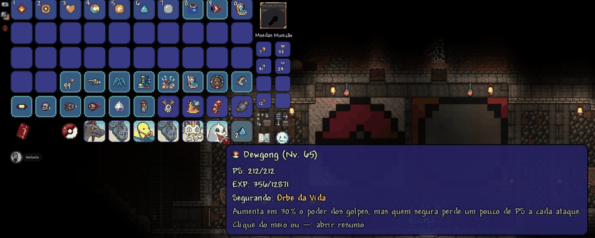  Your <b>party</b> stays on the side of the screen (<kbd>F</kbd> to show or hide it), and Pokémon in your inventory show their level, HP, EXP and held item when you hover them.</td>
</tr>
</table>

## 📦 Install

1. Download **Terramon.tmod** and **TmonRuntimes.tmod** from the [latest build](https://github.com/Welsete/Pokerraria_LoveStory/releases/tag/build-main).
2. Put both files in `Documents/My Games/Terraria/tModLoader/Mods`.
3. Open tModLoader, go to **Workshop → Manage Mods**, enable both and reload.
4. **Start a new world** to get the Gyms, the League, the Pokémon Center and Professor Oak.

The file is still called `Terramon.tmod` so saves from earlier versions keep working. Pokerraria: LoveStory replaces the original Terramon, so don't enable both. The language follows your game: Portuguese (Brasil) or English.

### Controls

| Key | What it does |
|:-:|---|
| <kbd>I</kbd> | Summary of a Pokémon |
| <kbd>P</kbd> | Pokédex |
| <kbd>F</kbd> | Show or hide the party |
| <kbd>'</kbd> | Send out or call back your partner |
| <kbd>[</kbd> <kbd>]</kbd> | Previous or next Pokémon |
| <kbd>L</kbd> | Battle history |
| <kbd>B</kbd> | Skip an evolution |
| <kbd>F8</kbd> | Test panel (only with Debug Mode on in the mod's settings) |

Every key can be changed in **Settings → Controls**.

## 🗺️ What's next

Done so far:

- [x] Turn-based battles, trainers, 8 Gyms, Elite Four and Champion
- [x] Level cap by badges, Pokémon Center with Nurse Joy, safe zone around your base
- [x] Mystery Dungeon sprites, portraits, Summary screen and Pokédex with filters
- [x] Professor Oak and the starter journey
- [x] Drawn animations for the first 18 moves

On the way:

- [ ] **The story:** the first chapters of *LoveStory*
- [ ] **More drawn move animations**, a few types at a time
- [ ] **Battle arenas by biome** and two-turn moves with their charge animation
- [ ] **More Pokémon Centers** you can build after four badges, and Nurse Joy's own sprite
- [ ] Walking sprites for every trainer, more Gyms, structures and NPCs with tips
- [ ] Eggs and a Day Care
- [ ] Items to train EVs and improve IVs
- [ ] Riding, surfing, flying and digging with your Pokémon
- [ ] Mega Evolution with a Mega Bracelet
- [ ] An emote bar to make your Pokémon pose

See every change in the [CHANGELOG](CHANGELOG.md).

## 🧪 For testers

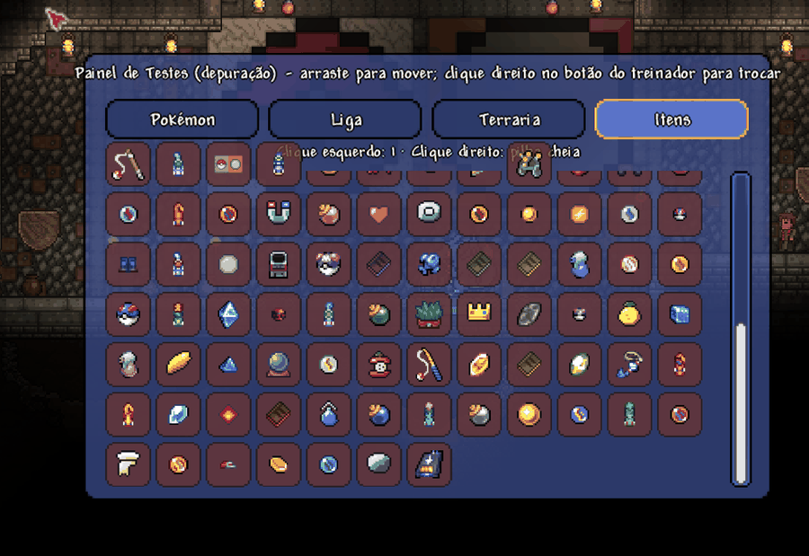

Turn on **Debug Mode** in the mod's settings and press <kbd>F8</kbd> for the test panel: heal, change levels, spawn Pokémon and items, call Gym Leaders, jump to any Gym or the Pokémon Center, change the weather and time, and try every move that has a drawn animation.

## 💛 Credits

- **Terramon** is made by the [Terramon team](https://github.com/JamzOJamz/Terramon) and licensed under GPL-3.0. This fork keeps the same license.
- **Pokémon sprites and portraits** come from the [PMD SpriteCollab](https://github.com/PMDCollab/SpriteCollab) project, licensed under CC BY-NC 4.0. The artists of each Pokémon are listed in [CREDITS.md](https://github.com/Welsete/Pokerraria_LoveStory/blob/main/Terramon/Assets/Pokemon/Anim/CREDITS.md).
- **Battles** run on [Pokémon Showdown](https://github.com/smogon/pokemon-showdown).
- **Pokerraria: LoveStory** original art for Brock, the held items, Onix, Professor Oak and the move animations.

Pokémon is © Nintendo, Game Freak and The Pokémon Company. This is a free, non-commercial fan project and is not affiliated with them.

## 🤝 Contributing

Found a bug or have an idea? Open an [issue](https://github.com/Welsete/Pokerraria_LoveStory/issues).
