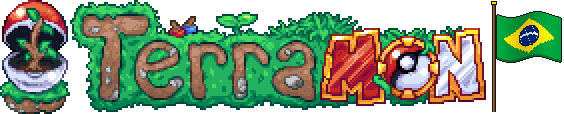
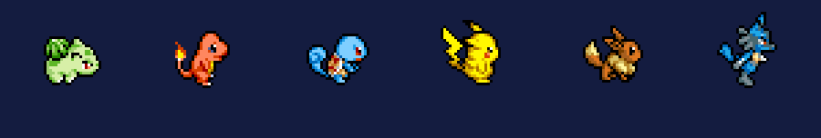
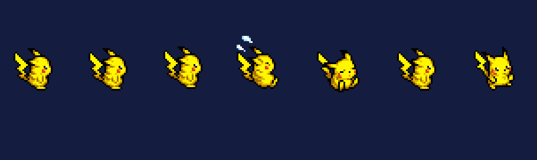
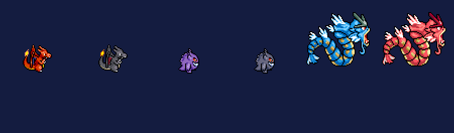
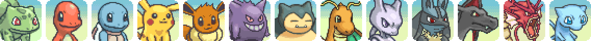
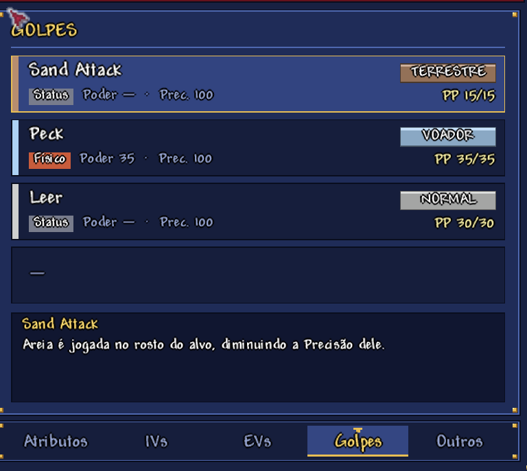
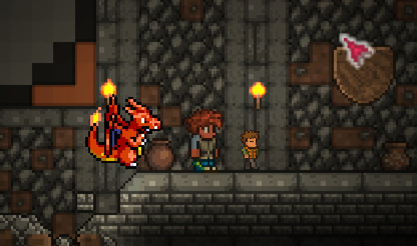

### Catch 'em all in Terraria. Beat the bosses. Earn the badges. Become the Champion.

  

**[Features](#-features)** · **[The League](#-the-road-to-the-league)** · **[Install](#-install)** · **[Roadmap](#-roadmap)** · **[Credits](#-credits)**

---

**Terramon Brasil** is a fan fork of [Terramon](https://github.com/JamzOJamz/Terramon) that turns Terraria into a full Pokémon journey, in the spirit of Cobblemon. Every Terraria boss you defeat opens the door to a new Gym Leader. Wild Pokémon grow stronger with your world. Battles are real turn-based Pokémon battles powered by Pokémon Showdown, and every Pokémon moves with hand-made Mystery Dungeon style animations.

Made in Brazil 🇧🇷, playable in Portuguese and English.

## ✨ Features

### Pokémon that feel alive

All 151 Kanto Pokémon and Lucario use sprites from the **PMD SpriteCollab**, with up to 15 animations each: idle, walk, physical attack, special attack, status move, hurt, sleep, faint, hop, lying down, waking up, tripping on a miss, eating when healed and a victory pose. The game picks the right one by itself, in battle and while your partner follows you around.

 Every Pokémon has its shiny form.

### Your team at a glance

<table>
<tr>
<td width="50%" valign="top">

**Summary screen** (middle click or <kbd>I</kbd> on any Pokémon)

- Stats, IVs and EVs as radar charts, with plain explanations of what they mean.
- Nature, ability with its description, held item and original trainer.
- Moves with power, accuracy, PP and description.
- **Change moves at any time** to any move your Pokémon could have learned by its level.
- Where it was met, friendship and which field abilities it has.

**Pokédex** with level-up moves, base stats, abilities, habitat, evolution line and an animated preview.

**Portraits** in the party sidebar and inventory, normal and shiny.

</td>
<td width="50%" valign="top">

</td>
</tr>
</table>

### Real Pokémon battles

- **Turn-based battles** powered by Pokémon Showdown, against wild Pokémon, trainers and other players.
- **Smart trainers** that play type matchups, STAB, setup and healing moves, and switch when it pays off.
- **Move effects** for every type and category, with the Pokémon acting out each move. Transform and Imposter really turn Ditto into its target.
- **Move details** on every button, and the full description on hover.
- **Bag in battle:** Potions, Revives and Poké Balls on your turn. Catch rate rises at low HP and with status conditions.
- **22 held items** drawn for the mod: Leftovers, Oran and Sitrus Berries, type boosters, Focus Sash, Life Orb, King's Rock, Shell Bell and more.
- **Battle log** in chat and a **battle history window** (<kbd>L</kbd>) with the whole fight turn by turn.
- **Evolution scene** with the classic white silhouette, light and fanfare (<kbd>B</kbd> to skip).

### A world full of Pokémon

<table>
<tr>
<td width="45%" valign="top">

</td>
<td width="55%" valign="top">

- **Professor Oak** welcomes new trainers, tells the story and hands over your first partner.
- **Gyms and a Pokémon League** generated in new worlds, plus Brock's cave gym near spawn.
- **Wild levels grow with your world:** boss progress and depth decide how strong wild Pokémon are.
- **Pokémon passives:** your partner helps you by type. Fire lights the way, Water lets you breathe longer, Ground mines faster, and Lucario's aura makes ores glow in caves.
- **Fishing** with Old, Good and Super Rods, evolution stones, apricorns from every tree and Exp. Candies from enemies and bosses.

</td>
</tr>
</table>

### Play together

Challenge friends with an accept or decline popup, fight friendly PvP battles that heal both teams afterwards, and see everyone's Pokémon synced in multiplayer.

## 🏆 The road to the League

Each Gym Leader appears after a Terraria boss and the previous badge. Call them from the gym pedestal or with their challenge item, crafted at a Work Bench.

| | Leader | Unlocked by | Badge |
|:-:|---|---|---|
| 1 | Brock | Eye of Cthulhu | Boulder Badge |
| 2 | Misty | Eater of Worlds or Brain of Cthulhu | Cascade Badge |
| 3 | Lt. Surge | Skeletron | Thunder Badge |
| 4 | Erika | Wall of Flesh (Hardmode) | Rainbow Badge |
| 5 | Koga | Any mechanical boss | Soul Badge |
| 6 | Sabrina | All three mechanical bosses | Marsh Badge |
| 7 | Blaine | Plantera | Volcano Badge |
| 8 | Giovanni | Golem | Earth Badge |
| | **Elite Four** | 8 badges and the Lunatic Cultist | Lorelei, Bruno, Agatha, Lance |
| | **Champion Blue** | Moon Lord | Hall of Fame |

## 📦 Install

1. Download **Terramon.tmod** and **TmonRuntimes.tmod** from the [latest build](https://github.com/Welsete/Terramon_Brasil/releases/tag/build-feature-ginasios).
2. Put both files in `Documents/My Games/Terraria/tModLoader/Mods`.
3. Open tModLoader, go to **Workshop → Manage Mods**, enable both and reload.
4. Start a new world to get the gyms, the League buildings and Professor Oak.

The language follows your game: Portuguese (Brasil) or English. Terramon Brasil replaces the original Terramon, so don't enable both.

**Controls:** <kbd>I</kbd> Summary · <kbd>L</kbd> battle history · <kbd>B</kbd> skip evolution · <kbd>F8</kbd> test panel (Debug Mode). Every key can be changed in Controls.

## 🗺️ Roadmap

- [x] Turn-based battles, trainers, 8 gyms, Elite Four and Champion
- [x] Mystery Dungeon sprites, portraits, Summary screen and new Pokédex
- [x] Professor Oak and the starter journey
- [ ] Eggs and a Day Care
- [ ] Items to train EVs and improve IVs
- [ ] Riding, surfing, flying and digging with your Pokémon
- [ ] Mega Evolution with a Mega Bracelet
- [ ] An emote bar to make your Pokémon pose
- [ ] Walking sprites for every trainer, more gyms, structures and NPCs with tips

## 💛 Credits

- **Terramon** is made by the [Terramon team](https://github.com/JamzOJamz/Terramon) and licensed under GPL-3.0. This fork keeps the same license.
- **Pokémon sprites and portraits** come from the [PMD SpriteCollab](https://github.com/PMDCollab/SpriteCollab) project, licensed under CC BY-NC 4.0. The artists of each Pokémon are listed in [CREDITS.md](Terramon/Assets/Pokemon/Anim/CREDITS.md).
- **Battles** run on [Pokémon Showdown](https://github.com/smogon/pokemon-showdown).
- **Terramon Brasil** art for Brock, the held items, Onix and Professor Oak by Isa.

Pokémon is © Nintendo, Game Freak and The Pokémon Company. This is a free, non-commercial fan project and is not affiliated with them.

## 🤝 Contributing

Found a bug or have an idea? Open an [issue](https://github.com/Welsete/Terramon_Brasil/issues).
